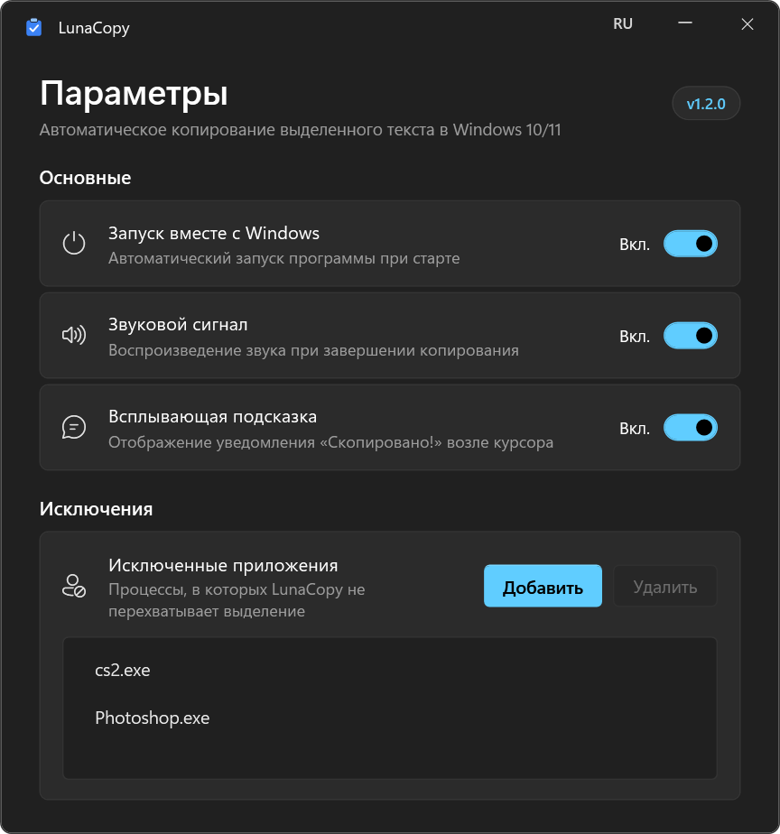

<h1 align="center">LunaCopy</h1>

<p align="center">
  <b>Автоматическое копирование выделенного мышью текста в буфер обмена для Windows 10 и 11.</b>
</p>

<p align="center">
  Фоновая системная утилита на C# и WPF (.NET 8), которая отслеживает выделение текста
  мышью в любых окнах и копирует его без нажатия Ctrl+C. Работает через UI Automation
  с безопасным откатом к системному буферу обмена, пропускает поля паролей, терминалы
  и полноэкранные игры.
</p>

<p align="center">
  
  
  
</p>

<p align="center">
  <a href="#почему-lunacopy">Почему LunaCopy</a> ·
  <a href="#возможности">Возможности</a> ·
  <a href="#установка-и-запуск">Установка и запуск</a> ·
  <a href="#сборка-из-исходников">Сборка</a> ·
  <a href="#логи-и-ограничения-windows">Логи и ограничения</a> ·
  <a href="#архитектура">Архитектура</a> ·
  <a href="#лицензия">Лицензия</a> ·
  <a href="README_EN.md"><b>English</b></a>
</p>

<br>

<p align="center">
  
  <br><sub><b>Окно параметров LunaCopy.</b> Настройка уведомлений, списка исключений, автозапуска и языка интерфейса.</sub>
</p>

## Почему LunaCopy

- **Точное распознавание выделения.** Утилита реагирует только на протяжку мыши (`> 5 px`) или двойной клик по слову в клиентской области окна (`HTCLIENT`), когда активен текстовый курсор `IDC_IBEAM`. Одиночные клики, перетаскивание файлов в Проводнике, скроллбары, заголовки окон и выделение с зажатыми `Ctrl`, `Shift`, `Alt` или `Win` игнорируются.
- **Чтение без эмуляции клавиш.** Сначала текст запрашивается напрямую у контрола через Windows UI Automation (`TextPattern`). Если приложение не поддерживает UIA, отправляется синтетический `Ctrl+C` с проверкой `GetClipboardSequenceNumber()`. Если в буфере не появилось нового текста, предыдущее содержимое (изображения, файлы, разметка) восстанавливается.
- **Защита паролей и консолей.** Поля с атрибутом `IsPassword` отсекаются на уровне UI Automation, поэтому выделение в менеджерах паролей и формах входа не попадает в буфер обмена. В консольные процессы (`cmd.exe`, `powershell.exe`, `pwsh.exe`, `wsl.exe`, `conhost.exe`) никогда не посылается `Ctrl+C`, чтобы не прервать выполняющуюся команду.
- **Тихий режим в играх.** Через `SHQueryUserNotificationState` утилита определяет полноэкранные Direct3D/эксклюзивные приложения и режим презентации, временно отключая перехват до выхода из полноэкранного режима.
- **Отклик без перехвата фокуса.** Всплывающая плашка «Скопировано» создается с флагами `WS_EX_NOACTIVATE | WS_EX_TRANSPARENT` и не сбивает активное окно или ввод с клавиатуры. Звуковой щелчок генерируется процедурно в памяти с хвостовой тишиной, чтобы не обрезаться на Bluetooth-наушниках.

## Возможности

| Область | Описание |
|---|---|
| **Жесты мыши** | Выделение перетаскиванием (`drag-select > 5 px`) и двойной клик по слову; фильтр ложных срабатываний по `WM_NCHITTEST` и системному курсору `IDC_IBEAM` |
| **Извлечение текста** | Двухуровневый пайплайн: нативный `UIAutomationClient` (`TextPattern` с таймаутом 120 мс) и резервный `SendInput` (`Ctrl+C`) |
| **Сохранность буфера** | Снимок `DataObject` перед отправкой `Ctrl+C` и автоматический возврат исходных данных, если выделение оказалось пустым или нетекстовым |
| **Безопасность** | Пропуск полей с флагом `IsPassword`; запрет синтетического `Ctrl+C` в терминалах; фильтрация дубликатов подряд |
| **Исключения** | Отключение в полноэкранных 3D-приложениях; черный список процессов с добавлением активного окна в один клик из меню трея |
| **Обратная связь** | Неактивируемое всплывающее окно у курсора и короткий процедурный WAV-сигнал (~800 Гц), отключаемые по отдельности |
| **Интерфейс** | Темная тема в стиле Windows 11 (`#202020` / `#2B2B2B`), скругление углов через DWM API, поддержка `PerMonitorV2` High-DPI, русский и английский языки (`AUTO / RU / EN`) |

## Установка и запуск

Для работы требуется 64-разрядная Windows 10 (1809 или новее) либо Windows 11 и установленный пакет [.NET 8.0 Desktop Runtime (x64)](https://dotnet.microsoft.com/download/dotnet/8.0).

Скачайте `LunaCopy.exe` со страницы [Releases](https://github.com/lunacy-devops/LunaCopy/releases) и запустите файл. Программа работает в фоновом режиме и размещает иконку в системном трее. Повторный запуск второго экземпляра блокируется глобальным мьютексом.

Левый клик по иконке в трее включает или приостанавливает автокопирование. Правый клик открывает контекстное меню: в нем можно переключить активность утилиты, одним нажатием добавить текущее открытое приложение в список исключений, открыть окно настроек или полностью выгрузить процесс со снятием глобальных хуков.

## Сборка из исходников

```powershell
git clone https://github.com/lunacy-devops/LunaCopy.git
cd LunaCopy

dotnet test tests/LunaCopy.Tests/LunaCopy.Tests.csproj -c Release
dotnet publish LunaCopy.csproj -c Release -r win-x64 -o publish
```

Готовый исполняемый файл создается по пути `publish/LunaCopy.exe`.

## Логи и ограничения Windows

Настройки сохраняются атомарно через временный файл в `%AppData%\LunaCopy\config.json` (если папка программы доступна для записи и уже содержит конфигурацию, используется локальный файл). Журнал событий и ошибок пишется в `%AppData%\LunaCopy\LunaCopy.log` с автоматической ротацией при достижении 1 МБ. Содержимое самого скопированного текста в лог никогда не записывается — фиксируется только длина строки и имя процесса.

**Окна с правами администратора (UIPI).** Механизм User Interface Privilege Isolation в Windows запрещает процессам со стандартным уровнем привилегий читать состояние или отправлять ввод в окна, запущенные от имени администратора. Чтобы копирование работало в таких приложениях (например, в Диспетчере задач или Редакторе реестра), сам `LunaCopy.exe` должен быть запущен с правами администратора.

**Нестандартные курсоры.** В приложениях, которые рисуют собственный графический курсор вместо системного `IDC_IBEAM`, чтение выделения выполняется только через UI Automation. Если такое приложение не поддерживает UIA, резервная отправка `Ctrl+C` намеренно не выполняется, чтобы избежать ложных срабатываний при рисовании или перетаскивании объектов.

## Архитектура

| Компонент | Файлы | Назначение |
|---|---|---|
| **Win32 Interop** | `Native/NativeMethods.cs` | P/Invoke для `WH_MOUSE_LL`, `SetWinEventHook`, `SendInput`, `WM_NCHITTEST`, курсоров, DWM и `SHQueryUserNotificationState` |
| **Перехват мыши** | `Services/MouseHookService.cs`, `Services/SelectionGestureDetector.cs` | Низкоуровневый хук мыши, отслеживание активного окна и чистая логика распознавания жестов выделения |
| **Извлечение текста** | `Services/TextExtractorService.cs` | Чтение через UI Automation в фоновом STA-потоке с таймаутом, проверка `IsPassword`, fallback `Ctrl+C` и сохранение буфера |
| **Конфигурация и логи** | `Services/ConfigService.cs`, `Services/Logger.cs`, `Services/Loc.cs` | Атомарное чтение/запись JSON-настроек, управление автозапуском в реестре, ротация логов и локализация (`RU` / `EN`) |
| **Звук и иконки** | `Services/SoundService.cs`, `Services/IconGenerator.cs` | Процедурный синтез WAV-сигнала в памяти и генерация иконок состояния для системного трея |
| **Окна WPF** | `Windows/*.xaml(.cs)` | Окно настроек, всплывающий тост у курсора, кастомное меню трея и диалог выбора процесса для исключений |
| **Тесты** | `tests/LunaCopy.Tests/` | Модульные тесты детектора жестов, сериализации конфигурации и полноты словарей локализации |

## Лицензия

Проект распространяется на условиях лицензии [MIT](LICENSE).
