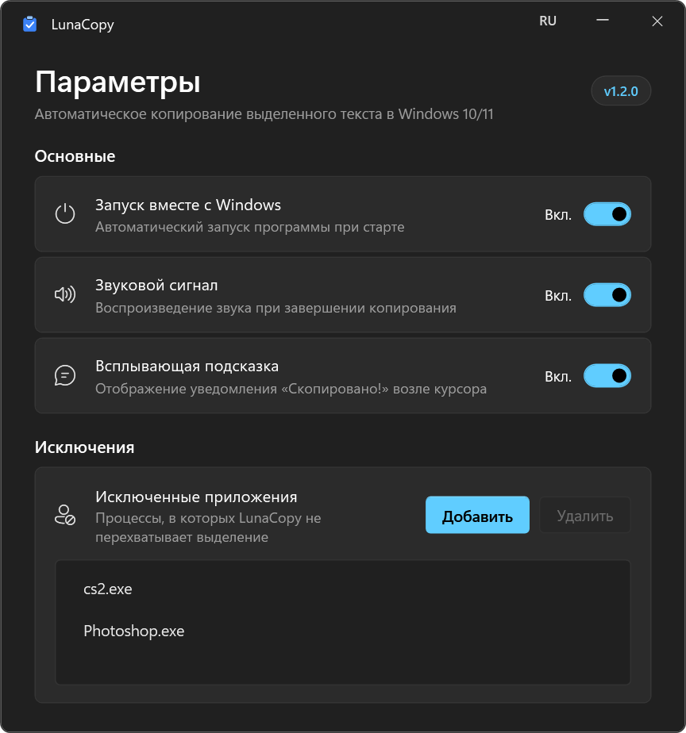

<h1 align="center">LunaCopy</h1>

<p align="center">
  <b>Automatic copy-on-select utility for Windows 10 and 11.</b>
</p>

<p align="center">
  A lightweight background tray utility built with C# and WPF (.NET 8) that copies mouse-selected
  text to the clipboard without pressing Ctrl+C. It reads selections natively through Windows
  UI Automation with a clipboard-preserving fallback, skips password fields, terminals, and
  fullscreen games, and stays out of the way.
</p>

<p align="center">
  
  
  
</p>

<p align="center">
  <a href="#why-lunacopy">Why LunaCopy</a> ·
  <a href="#features">Features</a> ·
  <a href="#installation-and-usage">Installation and usage</a> ·
  <a href="#building-from-source">Building</a> ·
  <a href="#logs-and-windows-notes">Logs and Windows notes</a> ·
  <a href="#architecture">Architecture</a> ·
  <a href="#license">License</a> ·
  <a href="README.md"><b>Русский</b></a>
</p>

<br>

<p align="center">
  
  <br><sub><b>LunaCopy Settings.</b> Notification toggles, process exclusions, startup configuration, and interface language.</sub>
</p>

## Why LunaCopy

- **Strict selection filtering.** Triggers only on mouse drag selections (`> 5 px`) or word double-clicks inside a window's client area (`HTCLIENT`) while the standard `IDC_IBEAM` text cursor is active. Single clicks, file drags in Explorer, scrollbar interactions, window border resizing, and selections made with `Ctrl`, `Shift`, `Alt`, or `Win` held down are ignored.
- **Two-stage text extraction.** First attempts to read the active selection directly via Windows UI Automation (`TextPattern`) without synthesizing keystrokes. When a control does not expose UIA, LunaCopy sends a synthetic `Ctrl+C` and verifies `GetClipboardSequenceNumber()`. If no new text arrives, previous clipboard contents (images, files, rich formats) are restored.
- **Password and terminal safety.** Controls marked with the UIA `IsPassword` attribute are skipped before extraction. Console hosts (`cmd.exe`, `powershell.exe`, `pwsh.exe`, `wsl.exe`, `conhost.exe`) never receive synthetic `Ctrl+C` events, preventing accidental interruption of running processes.
- **Fullscreen awareness.** Queries `SHQueryUserNotificationState` to detect fullscreen Direct3D games and presentation mode, pausing capture automatically until you return to the desktop.
- **Non-intrusive feedback.** The optional floating "Copied" toast uses `WS_EX_NOACTIVATE | WS_EX_TRANSPARENT` so it never steals focus or interrupts typing. The optional soft click sound is synthesized in memory with trailing silence to prevent Bluetooth audio clipping.

## Features

| Area | Details |
|---|---|
| **Mouse gestures** | Drag-select (`> 5 px`) and double-click word selection; false-positive filtering via `WM_NCHITTEST` and `IDC_IBEAM` cursor verification |
| **Text extraction** | Two-tier pipeline: native `UIAutomationClient` (`TextPattern` with a 120 ms timeout) and `SendInput` (`Ctrl+C`) fallback |
| **Clipboard preservation** | Captures the current `DataObject` prior to fallback `Ctrl+C` and restores it if no text was copied |
| **Safety** | Skips `IsPassword` fields; blocks synthetic `Ctrl+C` in terminal emulators and shells; suppresses consecutive duplicate copies |
| **Exclusions** | Automatic suspension in fullscreen 3D applications; per-process blocklist with one-click exclusion from the tray menu |
| **Feedback** | Focus-safe cursor toast and procedural WAV pop (~800 Hz), each independently toggleable |
| **Interface** | Windows 11 dark styling (`#202020` / `#2B2B2B`), DWM rounded corners, `PerMonitorV2` High-DPI scaling, Russian and English UI (`AUTO / RU / EN`) |

## Installation and usage

Requires 64-bit Windows 10 (version 1809 or newer) or Windows 11 and the [.NET 8.0 Desktop Runtime (x64)](https://dotnet.microsoft.com/download/dotnet/8.0).

Download `LunaCopy.exe` from [Releases](https://github.com/lunacy-devops/LunaCopy/releases) and run it. The application starts in the system tray and enforces a single instance via a global mutex.

Left-clicking the tray icon toggles auto-copy on or off. Right-clicking opens the tray menu, where you can toggle the service, exclude or re-enable the currently active foreground application in one click, open the settings window, or exit cleanly with all global hooks detached.

## Building from source

```powershell
git clone https://github.com/lunacy-devops/LunaCopy.git
cd LunaCopy

dotnet test tests/LunaCopy.Tests/LunaCopy.Tests.csproj -c Release
dotnet publish LunaCopy.csproj -c Release -r win-x64 -o publish
```

The compiled binary is written to `publish/LunaCopy.exe`.

## Logs and Windows notes

Configuration is saved atomically via a temporary file to `%AppData%\LunaCopy\config.json` (or next to the executable in portable setups). Diagnostic events and errors are written to `%AppData%\LunaCopy\LunaCopy.log` and rotated automatically at 1 MB. Copied text is never written to the log file; only character counts and process names are recorded.

**Elevated windows (UIPI).** Windows User Interface Privilege Isolation prevents a standard user-level process from inspecting or sending input to windows running as Administrator. To copy text from elevated applications such as Task Manager or Registry Editor, launch `LunaCopy.exe` as Administrator.

**Custom graphical cursors.** Applications that replace the standard `IDC_IBEAM` cursor with a custom bitmap are supported through UI Automation. If an application neither exposes UIA `TextPattern` nor uses the standard text cursor, the `Ctrl+C` fallback is intentionally skipped to avoid unintended clipboard changes during canvas dragging or drawing.

## Architecture

| Component | Files | Purpose |
|---|---|---|
| **Win32 Interop** | `Native/NativeMethods.cs` | P/Invoke declarations for `WH_MOUSE_LL`, `SetWinEventHook`, `SendInput`, `WM_NCHITTEST`, cursors, DWM, and `SHQueryUserNotificationState` |
| **Mouse hook** | `Services/MouseHookService.cs`, `Services/SelectionGestureDetector.cs` | Low-level mouse hook, foreground window tracking, and gesture detection logic |
| **Text extraction** | `Services/TextExtractorService.cs` | Background STA UI Automation reader with timeout protection, `IsPassword` checks, `Ctrl+C` fallback, and clipboard restoration |
| **Config and logging** | `Services/ConfigService.cs`, `Services/Logger.cs`, `Services/Loc.cs` | Atomic JSON configuration, registry startup management, log rotation, and localization (`RU` / `EN`) |
| **Audio and icons** | `Services/SoundService.cs`, `Services/IconGenerator.cs` | In-memory procedural WAV synthesis and dynamic tray icon rendering |
| **WPF windows** | `Windows/*.xaml(.cs)` | Settings window, non-activating cursor toast, custom tray menu, and running-process picker dialog |
| **Tests** | `tests/LunaCopy.Tests/` | Unit tests for gesture detection, configuration persistence, and localization key parity |

## License

Licensed under the [MIT License](LICENSE).
